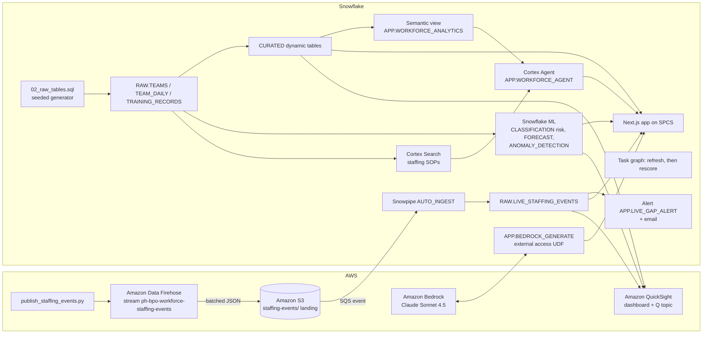

# Philippines BPO Workforce Operations - Staffing Gaps and Service Risk

End-to-end workforce operations for **40 agent teams of a fictional Philippine BPO, Bagwis Contact Services, across 5 cities** (Makati City, Cebu City, Davao City, Iloilo City, Bacolod City) using Snowflake, optionally with AWS: from a live interval staffing event to a 7-day staffing-gap risk score, an alert email and an AI action memo for the workforce management team. All data is team-level and synthetic; there are no agent-level records.

## Architecture

A workforce-operations pipeline built on **Snowflake** (Dynamic Tables, Snowflake ML, Cortex Search, Cortex Agent, Cortex AI_COMPLETE, SPCS) and, in the full build, **AWS** (Amazon Data Firehose, S3, Bedrock Claude, QuickSight + Amazon Q). Interval staffing events (calls waiting, longest wait, GAP or OK) land in `RAW.LIVE_STAFFING_EVENTS`. Dynamic tables curate 90 days of team-day history: contacts handled, labour cost, workforce events logged (unplanned absence surges, call volume spikes, resignation clusters, CRM slowdowns and more), events that left the team understaffed against forecast, client SLA breaches, QA calibration compliance and compliance training coverage. Snowflake ML scores 7-day staffing-gap risk per team, forecasts company-wide workforce-event volume and flags unplanned absence anomalies. A Cortex Agent answers questions with SOP citations, and an LLM drafts the workforce action memo.

Interactive diagrams (hover for object names): [Snowflake only](docs/architecture-snowflake.html) | [AWS + Snowflake](docs/architecture-aws.html). The app shows both on its Architecture & Data tab, the current build first. Regenerate them with `python3 docs/build_architecture.py`.



The Snowflake-only build drops the AWS subgraph: `APP.SIMULATE_STAFFING_EVENTS` writes to `RAW.LIVE_STAFFING_EVENTS`, and the app calls Cortex `AI_COMPLETE` instead of the Bedrock UDF.

## Snowflake Capabilities

| Capability | Implementation |
|-----------|---------------|
| Dynamic Tables | `CURATED.KPI_SUMMARY`, `PERFORMANCE_SUMMARY`, `EVENT_TYPE_SUMMARY`, `TREND_ANALYSIS` from the RAW tables |
| Snowflake ML | CLASSIFICATION 7-day staffing-gap risk (`ML.GAP_RISK_SCORES`), 14-day workforce-event FORECAST, unplanned absence ANOMALY_DETECTION |
| Cortex Search | 14 synthetic staffing-response SOPs (one per line of business and event type) in `SEARCH.WORKFORCE_SOP_SEARCH` |
| Semantic View | `APP.WORKFORCE_ANALYTICS` over teams, event types, daily totals and risk |
| Cortex Agent | `APP.WORKFORCE_AGENT`: Cortex Analyst over the semantic view plus Cortex Search for SOP citations |
| Cortex AI | `AI_COMPLETE('claude-sonnet-4-5')` for grounded answers, and for the action memo in the Snowflake-only build |
| Alerts + Tasks | `APP.LIVE_GAP_ALERT` logs GAP events and sends email; task graph `TASK_REFRESH_CURATED`, then `TASK_RESCORE_RISK` |
| Snowpark Container Services | Next.js app `APP.PH_BPO_WORKFORCE_APP` with 6 tabs: Executive Cockpit, Predictive, Quality & Training, Live Staffing, Ask AI, Architecture & Data |
| Snowpipe | `RAW.LIVE_STAFFING_EVENTS_PIPE` AUTO_INGEST from S3 (AWS build only) |

## AWS Services

Used only in the AWS + Snowflake build.

| Service | Role in Demo |
|---------|-------------|
| Amazon Data Firehose | Direct PUT stream `ph-bpo-workforce-staffing-events` receives simulated interval staffing events and writes batches to S3 |
| Amazon S3 | Landing bucket (`staffing-events/`). An event notification goes to the Snowpipe SQS queue |
| Amazon Bedrock | Claude Sonnet 4.5 writes the action memo, called from Snowflake through an external-access UDF |
| Amazon QuickSight | DIRECT_QUERY executive dashboard over Snowflake (daily workforce events, staffing gaps by team, staffing-gap risk) |
| Amazon Q | Natural-language questions over the QuickSight topic `ph-bpo-workforce-topic` |
| AWS IAM | Least-privilege roles for S3, Firehose and Bedrock |

## Personas

These personas are fictional.

| Persona | Role | Key Questions |
|---------|------|---------------|
| **Carmela Bautista** | Head of Workforce Management | "Which workforce events leave teams understaffed?" "Which cities need backfill from the next training wave?" |
| **Jerome Santiago** | Real-time Workforce Analyst | "Which teams are high risk this week, and which SOP applies?" |

## Data

All data is synthetic and seeded, so every rebuild reproduces it. The company, sites, teams and names are fictional. Rows are team-level aggregates; there are no agent-level or personal records.

| Table | Rows | Description |
|-------|------|-------------|
| RAW.TEAMS | 40 | Agent teams in 5 Philippine cities and 5 lines of business (Voice customer care, Technical support, Collections, Back-office processing, Overnight chat support), with risk tier and average agent tenure |
| RAW.TEAM_DAILY | 3,600 | Daily team observations over 90 days: contacts handled, labour cost (PHP), workforce events, staffing-gap events, client SLA breaches, event type, QA calibration reviews, unplanned absence and average handle time |
| RAW.TRAINING_RECORDS | 40 | Required, completed and pending compliance training per team |
| SEARCH.WORKFORCE_SOP_DOCS | 14 | Synthetic staffing-response SOPs indexed for Cortex Search |
| RAW.LIVE_STAFFING_EVENTS | Grows during the demo | Live interval staffing events from Firehose (AWS build) or `APP.SIMULATE_STAFFING_EVENTS` (Snowflake-only build) |
| ML.GAP_RISK_SCORES | 40 | 7-day staffing-gap probability and risk band per team |

## Build Instructions

### Prerequisites
- Snowflake account with ACCOUNTADMIN access, and Cortex AI enabled (AI_COMPLETE, Search, Agent).
- An X-Small warehouse with auto-suspend at or below 120 s, and an existing SPCS compute pool.
- Python 3.11+, `snowflake-connector-python`, Node.js 22+, Docker and the `snow` CLI.
- App image: run `snow spcs image-registry login`, then build and push `ph-bpo-workforce-app:v1` to the database's `APP.IMAGES` repository (see the header of `snowflake/07_deploy_app.sql`).
- AWS build only: `boto3`, AWS credentials for the target account (us-west-2) with Bedrock access, and QuickSight Enterprise.

### SPCS App
```
<DATABASE>.APP.PH_BPO_WORKFORCE_APP
```

### Tests
```bash
python -m pytest aws snowflake quicksight
```

For a local run, put `SNOWFLAKE_ACCOUNT`, `SNOWFLAKE_USER`, `SNOWFLAKE_DATABASE`, `SNOWFLAKE_WAREHOUSE`, `SNOWFLAKE_AUTHENTICATOR=PROGRAMMATIC_ACCESS_TOKEN`, `SNOWFLAKE_TOKEN` and `DEMO_PLATFORM` in the environment, then run `npm --prefix app run build && npm --prefix app start`.

## Build Modes

Both modes share the same core. They differ in three places, and the app's `DEMO_PLATFORM` setting (in its SPCS spec) switches the memo provider and the Live Staffing tab.

| Layer | Snowflake Only | Full AWS + Snowflake |
|---|---|---|
| Live staffing events | `CALL APP.SIMULATE_STAFFING_EVENTS(n)` inserts simulated interval staffing events into `RAW.LIVE_STAFFING_EVENTS`. This simulates an interval staffing feed; it is not Snowpipe Streaming | `aws/publish_staffing_events.py` to Amazon Data Firehose, then S3, SQS and Snowpipe AUTO_INGEST |
| Action memo | Cortex `AI_COMPLETE('claude-sonnet-4-5')` | Amazon Bedrock Claude Sonnet 4.5 through `APP.BEDROCK_GENERATE` |
| BI and natural-language questions | The SPCS app is the dashboard; questions go to the Cortex Agent | Also a QuickSight dashboard and an Amazon Q topic |
| App setting | `DEMO_PLATFORM: snowflake` | `DEMO_PLATFORM: aws` |

### Snowflake Only

```bash
# 1. Core data and dynamic tables (guarded: new isolated database only)
python snowflake/run_core.py --database PHILIPPINES_BPO_WORKFORCE_SNOWFLAKE --warehouse <XS_WAREHOUSE> --connection <CONNECTION> --apply
# 2. Native staffing feed, ML, search, semantic view, agent, alert and task graph
python snowflake/run_intelligence.py --database PHILIPPINES_BPO_WORKFORCE_SNOWFLAKE --platform snowflake --warehouse <XS_WAREHOUSE> --connection <CONNECTION> --alert-email you@example.com
# 3. App on SPCS with DEMO_PLATFORM=snowflake (push the image first)
python snowflake/run_intelligence.py --database PHILIPPINES_BPO_WORKFORCE_SNOWFLAKE --platform snowflake --warehouse <XS_WAREHOUSE> --connection <CONNECTION> --alert-email you@example.com --files 07_deploy_app.sql --compute-pool <COMPUTE_POOL>
```

During the demo:
- Run `CALL APP.SIMULATE_STAFFING_EVENTS(20)` to add live interval staffing events. For a continuous feed, run `ALTER TASK APP.TASK_SIMULATE_STAFFING_EVENTS RESUME`, and `SUSPEND` it afterwards.
- Run `EXECUTE ALERT APP.LIVE_GAP_ALERT` to raise the alert email.
- Run `EXECUTE TASK APP.TASK_REFRESH_CURATED` to refresh the curated tables and rescore risk.

Afterwards, drop the database or run `ALTER SERVICE APP.PH_BPO_WORKFORCE_APP SUSPEND`.

### Full AWS + Snowflake

```bash
# 1. Core data and dynamic tables (guarded: new isolated database only)
python snowflake/run_core.py --database PHILIPPINES_BPO_WORKFORCE_AWS --warehouse <XS_WAREHOUSE> --connection <CONNECTION> --apply
# 2. AWS ingestion and Bedrock (dry run first, then --apply)
python aws/setup_aws.py --database PHILIPPINES_BPO_WORKFORCE_AWS --account <AWS_ACCOUNT_ID> --connection <CONNECTION> --apply
# 3. ML, search, semantic view, agent, alert and task graph
python snowflake/run_intelligence.py --database PHILIPPINES_BPO_WORKFORCE_AWS --platform aws --warehouse <XS_WAREHOUSE> --connection <CONNECTION> --alert-email you@example.com
# 4. App on SPCS with DEMO_PLATFORM=aws (push the image first)
python snowflake/run_intelligence.py --database PHILIPPINES_BPO_WORKFORCE_AWS --platform aws --warehouse <XS_WAREHOUSE> --connection <CONNECTION> --alert-email you@example.com --files 07_deploy_app.sql --compute-pool <COMPUTE_POOL>
# 5. QuickSight dashboard and Q topic (needs an existing Snowflake data source)
python quicksight/build_dashboards.py --database PHILIPPINES_BPO_WORKFORCE_AWS --account <AWS_ACCOUNT_ID> --principal-arn <QUICKSIGHT_USER_ARN> --data-source-arn <DATA_SOURCE_ARN> --prefix ph-bpo-workforce --apply --update --with-topic
```

QuickSight objects must be shared with the QuickSight user who signs in (`--principal-arn`); otherwise the console shows nothing.

During the demo:
- Run `python aws/publish_staffing_events.py --count 20` to send live interval staffing events. Firehose buffers for up to 60 seconds before writing to S3.
- Run `EXECUTE ALERT APP.LIVE_GAP_ALERT` to raise the alert email.
- Run `EXECUTE TASK APP.TASK_REFRESH_CURATED` to refresh the curated tables and rescore risk.

Afterwards, `python aws/teardown_aws.py --database PHILIPPINES_BPO_WORKFORCE_AWS --account <AWS_ACCOUNT_ID> --connection <CONNECTION> --apply` removes the AWS resources and the account-level Bedrock external-access and S3 storage integrations. It leaves the email integration `PH_BPO_WORKFORCE_EMAIL_INT`, which the Snowflake-only build also uses.

## Business Impact

Industry context and Snowflake customer outcomes:
- **Industry ambition**: the IT-BPM Roadmap 2028 "aims to significantly grow the country's Information Technology and Business Process Management (IT-BPM) industry by 2028, targeting $59 billion in revenue" -- [IT & Business Process Association of the Philippines (IBPAP), The IT-BPM Roadmap 2028](https://ibpap.org/)
- **AMN Healthcare** (Snowflake customer), a healthcare staffing company: "When strikes occur, clients need near real-time dashboards to staff up quickly" -- [Snowflake customer story: AMN Healthcare](https://www.snowflake.com/en/customers/all-customers/case-study/amn-healthcare/)
- **AMN Healthcare** reports that its data environment costs "dropped to $14,000 per month—down from $200,000—despite storing approximately 50% more data" -- [Snowflake customer story: AMN Healthcare](https://www.snowflake.com/en/customers/all-customers/case-study/amn-healthcare/)

## Key Demo Numbers

These figures are synthetic and come from the seeded demo data. Forecast and anomaly figures can shift slightly with the build day.

- **40 agent teams** in 5 cities across 5 lines of business, 3,600 team-days over 90 days; **2,963,275 contacts handled** at a labour cost of PHP 182 M
- **Event-free contact rate 99.98%**: **591 workforce events** logged, of which **204** left the team understaffed against forecast (event gap rate 34.5%); **85 client SLA breaches**
- **Unplanned absence surges** produce the most staffing-gap events (54 of 144 events); the 16 typhoon site closures are always absorbed by moving queues to other sites
- **Bacolod City** teams log the most staffing-gap events (53) and **Davao City** the fewest (19)
- **Staffing-gap model** out-of-time holdout: precision 0.42, recall 0.22 at a 0.5 threshold, against a 0.253 base rate. Four teams are high risk; the top team is TM-0026, at 81.4%
- **14-day workforce-event forecast** with prediction intervals; **31 of 640** team-days flagged as unplanned absence anomalies
- **QA calibration compliance 69.5%**, compliance training coverage 57.3%, with 25 certifications pending
- **14 SOPs** indexed for Cortex Search and cited by ID in agent answers

## License

Apache 2.0 — See [LICENSE](LICENSE) for details.

This is a personal demo project and is not an official Snowflake offering. It comes with no support or warranty. Industry metrics cited are from publicly available third-party sources and Snowflake customer stories; they represent reported outcomes and are not guarantees of results.
